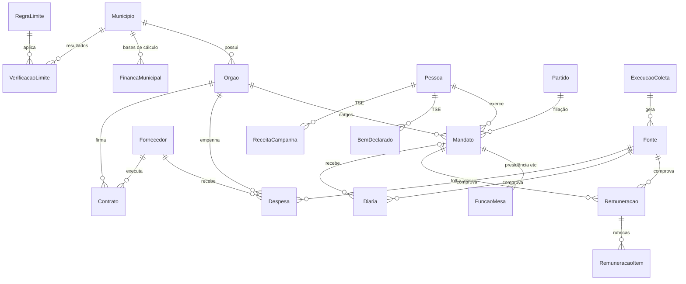

# FiscalizApp — Modelo de Dados

Schema: [`apps/api/prisma/schema.prisma`](../apps/api/prisma/schema.prisma)
(Prisma 7, PostgreSQL). Validado com `prisma validate`: 20 tabelas.

## Diagrama



## Grupos de tabelas

| Grupo | Tabelas | Origem dos dados |
|---|---|---|
| Território | `municipios`, `orgaos` | IBGE, cadastro manual |
| Pessoas e cargos | `pessoas`, `partidos`, `mandatos`, `funcoes_mesa` | TSE (eleitos), portais Atende.Net (agentes públicos), Câmara (mesa diretora) |
| Remuneração | `remuneracoes`, `remuneracao_itens` | Folha de pagamento no Atende.Net |
| Benefícios | `diarias` | Atende.Net (diárias) |
| Gastos | `despesas`, `fornecedores`, `contratos` | Atende.Net, TCE-PR (SIM-AM), PNCP |
| TSE | `bens_declarados`, `receitas_campanha` | TSE Dados Abertos |
| Limites legais | `financas_municipais`, `regras_limite`, `verificacoes_limite` | SICONFI, TCE-PR + regras da CF/LRF |
| Proveniência | `fontes`, `execucoes_coleta` | Gerado pelos coletores |
| Público | `reportes_erro` | Botão "Encontrou um erro?" |

## Decisões de modelagem

1. **Dinheiro em centavos (`BigInt`).** `R$ 11.859,18` → `1185918`. Na API sai
   como número inteiro (`valorCentavos`); quem formata é o front.
2. **Pessoa ≠ Mandato.** A mesma pessoa pode ser vereador numa legislatura e
   secretário na outra. Salário e diárias se ligam ao **mandato**, não à pessoa.
3. **Presidência da Câmara em tabela própria (`funcoes_mesa`).** A mesa muda
   a cada biênio. É isso que explica os R$ 4.000 a mais do presidente na
   folha (rubrica "verba de representação" em `remuneracao_itens`).
4. **Rubricas separadas (`remuneracao_itens`).** Permite mostrar "subsídio
   R$ 11.859,18 + representação R$ 4.000,00 − IRRF − INSS".
5. **Competência por `ano` + `mes` + `tipoFolha`.** O 13º e as férias não se
   misturam com a folha mensal no gráfico.
6. **Idempotência.** Cada tabela coletada tem `chaveOrigem` única por órgão
   (ou por eleição no TSE). O coletor faz `upsert`, então rodar de novo não
   duplica nada.
7. **Proveniência obrigatória.** Remuneração, diária, despesa, contrato, bens e
   receitas têm `fonteId` **não nulo**. `Fonte` guarda URL, data, hash SHA-256
   e caminho do arquivo bruto no object storage.
8. **`verificacao` controla a publicação.** Registros `NAO_VERIFICADO` (ex.: a
   semente da rede social) **não saem na API pública**. `DIVERGENTE` sai com
   aviso.
9. **LGPD.**
   - CPF de agente político: só `cpfHash` (SHA-256 com *pepper*), usado para
     casar TSE × folha.
   - CPF de fornecedor pessoa física: apenas mascarado, como o portal já publica.
   - CPF de doador pessoa física: só hash.
   - E-mail de quem reporta erro: opcional e apagado ao encerrar o reporte.
10. **Limites legais em configuração.** `regras_limite.parametros` (JSON) guarda
    as faixas e percentuais com vigência, porque mudam com emendas e com a
    população. O resultado fica em `verificacoes_limite.memoriaCalculo` para o
    botão "ver cálculo".

## Exemplo de `regras_limite`

```json
{
  "codigo": "CF_29_VI_SUBSIDIO_VEREADOR",
  "titulo": "Subsídio máximo do vereador",
  "baseLegal": "Constituição Federal, art. 29, VI",
  "explicacao": "Em cidades de 100.001 a 300.000 habitantes, o vereador pode ganhar no máximo 50% do salário de um deputado estadual.",
  "parametros": {
    "referencia": "SUBSIDIO_DEPUTADO_ESTADUAL_PR",
    "faixas": [
      { "popMin": 100001, "popMax": 300000, "percentual": 0.5 }
    ]
  },
  "vigenciaInicio": "2000-02-14"
}
```

> As faixas e percentuais precisam ser conferidos com o texto vigente da
> Constituição antes de entrar em produção. A vigência acima é ilustrativa.

## Dados semente

[`apps/api/prisma/seed/camara-campo-largo-2025.json`](../apps/api/prisma/seed/camara-campo-largo-2025.json)
traz o município, os dois órgãos (Atende.Net) e os 15 vereadores com o subsídio
do post. **Tudo entra como `NAO_VERIFICADO`** com fonte `REDE_SOCIAL`. Serve
para desenvolver telas e testes, não para publicar.

Soma de conferência: 15 subsídios = `18188770` centavos = **R$ 181.887,70/mês**.

## Próximos passos

- [ ] Script `prisma/seed/index.ts` lendo o JSON
- [ ] Extensões no primeiro migration: `pg_trgm` e `unaccent` (busca por nome)
- [ ] Índice GIN trigram em `pessoas.nomeUrna` e `pessoas.nomeCivil`
- [ ] Views materializadas para o resumo do município (custo mensal da Câmara)
